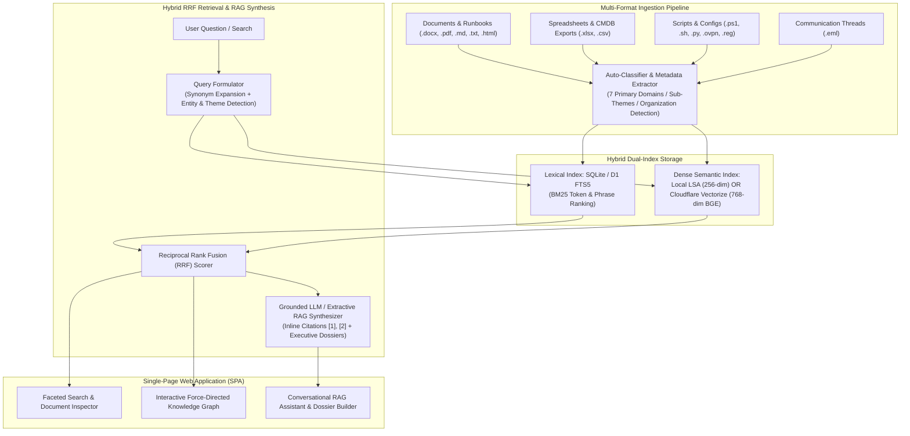

# Semantic RAG Knowledge Base & Interactive Topic Graph

> [!IMPORTANT]
> **Disclaimer:** This IT knowledge management tool has been designed as a proof of concept, a practical exercise to build and integrate **Python 3, FastAPI, Uvicorn, SQLite 3, SQLite FTS5 (BM25 lexical search), Scikit-Learn (TF-IDF & TruncatedSVD / Latent Semantic Analysis), NumPy, Reciprocal Rank Fusion (RRF), PyMuPDF, OOXML/Email/CSV document parsers, Cloudflare Workers (ES Modules), Cloudflare D1 (Serverless SQLite), Cloudflare Vectorize (768-dimension cosine vector index), Cloudflare Workers AI (`@cf/baai/bge-base-en-v1.5` embeddings & `@cf/meta/llama-3.3-70b-instruct-fp8-fast` LLM inference), Cloudflare v4 REST API & Wrangler, pluggable LLM APIs (Google Gemini, OpenAI, Anthropic, and local Ollama), HTML5 Canvas 2D force-directed graph physics, Vanilla JavaScript (ES6+) Single-Page Application (SPA), CSS3, HMAC-SHA256 session authentication, Docker, Docker Compose, and Linux systemd**. This is meant as a demonstration and should be used only for testing purposes.

**All the demo platforms currently deployed and running under my main domain are not publicly accessible. Please, email me if you would like a live demo. Thank you.**

[](#part-1-local--self-hosted-installation)
[](#part-1-local--self-hosted-installation)
[](#part-3-cloudflare-serverless-edge-deployment)
[](#option-b-docker-compose-deployment)
[](#license)

A self-contained, vendor-agnostic, full-stack **Hybrid Semantic Retrieval-Augmented Generation (RAG) Knowledge Base** and **Interactive Force-Directed Topic Graph** web application. Built to ingest, classify, search, curate, and synthesize multi-format technical documentation, Standard Operating Procedures (SOPs), automation scripts, spreadsheets, communication archives, and CMDB configuration inventories.

This repository supports **two interchangeable deployment targets** out of the box:
1. **Local / Self-Hosted Stack (`webapp/`)** — Runs on any local or on-premises environment (Windows, Linux, macOS, Docker, or Linux VM) using **FastAPI**, **SQLite FTS5**, local **TF-IDF + TruncatedSVD (LSA)** dense vector embeddings, and pluggable LLM backends (cloud LLM APIs, local Ollama, or 100% offline extractive synthesis).
2. **Cloudflare Serverless Edge Stack (`cloudflare-worker/`)** — Runs globally at the edge with zero servers to maintain using **Cloudflare Workers**, **Cloudflare D1** (serverless SQLite + FTS5), **Cloudflare Vectorize** (768-dimension dense vector index), and **Cloudflare Workers AI**.

---

## Table of Contents

1. [System Architecture](#system-architecture)
2. [Core Capabilities](#core-capabilities)
3. [Vendor-Agnostic Thematic Taxonomy](#vendor-agnostic-thematic-taxonomy)
4. [Repository Structure](#repository-structure)
5. [Part 1: Local & Self-Hosted Installation](#part-1-local--self-hosted-installation)
   - [Option A: Native Python (Windows / macOS / Linux)](#option-a-native-python-windows--macos--linux)
   - [Option B: Docker Compose Deployment](#option-b-docker-compose-deployment)
   - [Option C: Automated Debian / Ubuntu Systemd Deployment](#option-c-automated-debian--ubuntu-systemd-deployment)
6. [Part 2: Data Ingestion & Database Management](#part-2-data-ingestion--database-management)
7. [Part 3: Cloudflare Serverless Edge Deployment](#part-3-cloudflare-serverless-edge-deployment)
   - [Step 1: Create a Cloudflare API Token](#step-1-create-a-cloudflare-api-token)
   - [Step 2: Export Local Data to D1 SQL Migrations (Optional)](#step-2-export-local-data-to-d1-sql-migrations-optional)
   - [Step 3A: One-Command Automated REST Deployment (`deploy_cloudflare.py`)](#step-3a-one-command-automated-rest-deployment-deploy_cloudflarepy)
   - [Step 3B: Manual Deployment via Wrangler CLI](#step-3b-manual-deployment-via-wrangler-cli)
   - [Step 4: Build Edge Vectorize Embeddings](#step-4-build-edge-vectorize-embeddings)
   - [Step 5: Protect with Cloudflare Zero Trust Access (Recommended)](#step-5-protect-with-cloudflare-zero-trust-access-recommended)
8. [Configuration & Environment Variables](#configuration--environment-variables)
9. [REST API Reference](#rest-api-reference)
10. [License](#license)

---

## System Architecture



### Deployment Stack Comparison

| Component | Local / Self-Hosted (`webapp/`) | Cloudflare Edge (`cloudflare-worker/`) |
| :--- | :--- | :--- |
| **Runtime & API** | Python 3.10+ / FastAPI / Uvicorn | Cloudflare Workers (ES Module JavaScript) |
| **Relational & Lexical DB** | SQLite 3 (`./data/knowledge_base.db`) + FTS5 BM25 | Cloudflare D1 Serverless SQLite + FTS5 BM25 |
| **Semantic Vector Search** | Scikit-Learn TF-IDF + TruncatedSVD (256-dim LSA) | Cloudflare Vectorize (`@cf/baai/bge-base-en-v1.5`, 768-dim) |
| **Rank Fusion** | Reciprocal Rank Fusion (RRF) | Reciprocal Rank Fusion (RRF) |
| **LLM Synthesis** | Pluggable Cloud LLMs, Local Ollama, or Offline Extractive | Cloudflare Workers AI (`@cf/meta/llama-3.3-70b-instruct-fp8-fast`) + Offline Fallback |
| **Auto-Ingestion** | Background Watchdog (`./data/ingest/`) + Web Upload | Web UI Upload + Curated Note Creation + D1 Batch Sync |

---

## Core Capabilities

- **Hybrid Semantic + Lexical RRF Search**: Combines dense conceptual similarity with exact keyword and hostname BM25 matching via Reciprocal Rank Fusion:
  $$\text{RRF\_Score}(d) = \sum_{m \in \{\text{semantic}, \text{lexical}\}} \frac{w_m}{k + \text{rank}_m(d)}$$
- **AI Query Formulation & Conversational RAG**: Automatically expands technical acronyms and synonyms, detects referenced organization codes and thematic domains, generates follow-up investigative questions, and synthesizes grounded Markdown responses with clickable `[1]`, `[2]` source citations.
- **Interactive Topic & Entity Graph**: HTML5 Canvas force-directed graph visualizing connections between **Thematic Domains**, **Sub-Themes**, **Organizations**, and **Documents/Scripts**, complete with zoom/pan, node physics, neighborhood highlighting, and one-click inspection.
- **Automated Multi-Format Ingestion**:
  - Extracts full text and metadata from `.docx`, `.pdf`, `.xlsx`, `.csv`, `.eml`, `.ps1`, `.sh`, `.bat`, `.py`, `.md`, `.txt`, and `.html`.
  - Automatically classifies artifacts across **7 primary domains** and **31 sub-themes**.
  - Associates files, scripts, communication threads, and CMDB records with organization codes.
- **In-Place Knowledge Curation**: Edit document titles, reassign themes, add custom tags, write curated engineering notes, star high-value runbooks, and author new Markdown notes directly from the browser.
- **One-Click Executive & Technical Dossiers**: Generate structured Markdown syntheses for any Organization or Thematic Domain.

---

## Vendor-Agnostic Thematic Taxonomy

The classification engine organizes technical knowledge across **7 core IT & operations domains**:

1. **Backup & Disaster Recovery (BCDR)** — Image and virtual machine backup platforms, immutable repositories, cloud SaaS backup, disaster recovery runbooks, and NAS/SAN storage infrastructure.
2. **RMM, Automation & Endpoint Management** — PSA & Service Management, Automated Documentation & configuration inspection, RMM endpoint management, PowerShell/Bash/Python CLI scripting, and Active Directory / Group Policy administration.
3. **Cybersecurity, Identity & Network Security** — EDR, MDR & Threat Hunting, security awareness & phishing training, perimeter firewalls & VPNs, SSL/TLS certificates & disk encryption, and MFA / Zero-Trust / email authentication (SPF, DKIM, DMARC).
4. **Cloud, Virtualization & Core Infrastructure** — Public cloud infrastructure & virtual networking, cloud productivity & messaging tenants, hypervisor clusters, failover clustering, and Linux/container/SQL database workloads.
5. **Documentation & CMDB Configuration Management** — Documentation exports & runbooks, structured CMDB asset tables (`configurations`, `server-s`, `backup`, `firewall-auto`, `lan`, `active-directory`, `domains`, `ssl-certificates`), network assessments, and licensing/domain expiration tracking.
6. **MSP Operations, NOC & Service Delivery** — Standard Operating Procedures (SOPs) & troubleshooting checklists, centralized NOC alert triage & escalation matrices, client onboarding/offboarding workflows, and service delivery documentation.
7. **Training, Certifications & Professional Notes** — Technical certification study guides, architecture reference notes, and engineering lab documentation.

---

## Repository Structure

```text
├── data/
│   ├── ingest/                        # Watch folder: drop files or <ORG_CODE>/ subfolders here
│   ├── uploads/                       # Web UI uploaded files & user-created Markdown notes
│   └── knowledge_base.db              # Portable SQLite + FTS5 database (auto-created on startup)
├── webapp/
│   ├── app.py                         # FastAPI application, REST endpoints & session auth
│   ├── rag_engine.py                  # Hybrid LSA + FTS5 RRF search engine, LLM client & file parser
│   ├── static/index.html              # Self-hosted Single-Page Application (SPA) frontend
│   ├── Dockerfile                     # Production container image definition
│   ├── docker-compose.yml             # Docker Compose service configuration
│   ├── deploy_debian.sh               # Automated systemd installer for Debian/Ubuntu servers
│   └── requirements.txt               # Python package dependencies
├── cloudflare-worker/
│   ├── src/index.js                   # Cloudflare Worker serverless backend (D1 + Vectorize + AI)
│   ├── public/index.html              # Edge Single-Page Application (SPA) frontend
│   ├── migrations/                    # D1 SQL schema & synthetic example seed files (0001..0006)
│   ├── wrangler.toml                  # Cloudflare Wrangler configuration template
│   ├── deploy_cloudflare.py           # Zero-dependency Cloudflare REST API provisioning & deploy script
│   ├── deploy_cloudflare.ps1          # PowerShell wrapper for Cloudflare deployment
│   ├── deploy_cloudflare.sh           # Bash wrapper for Cloudflare deployment
│   └── export_to_d1.py                # Converts ./data/knowledge_base.db into D1 SQL migration batches
├── init_db.py                         # CLI utility to initialize, reset, seed examples, or import folders
├── purge_private_data.bat             # One-click Windows utility to reset local DB/model artifacts & re-seed
├── search_kb.py                       # Command-line search & statistics utility
├── kb_explorer.html                   # Standalone static HTML explorer previewing the sample dataset
├── THEMATIC_KNOWLEDGE_BASE.md         # Markdown reference of the 7 thematic domains & sample catalog
├── thematic_catalog.json              # Machine-readable JSON snapshot of the sample thematic catalog
├── .env.example                       # Environment variable template with generic placeholders
└── .gitignore                         # Excludes .env, *.db, *.pkl, and user-uploaded data from Git
```

---

## Part 1: Local & Self-Hosted Installation

The application is completely self-contained and independent of its parent directory. All database files, vector models, and ingested documents are stored inside `./data/`.

### Option A: Native Python (Windows / macOS / Linux)

#### 1. Clone the Repository & Create a Virtual Environment

**Windows (PowerShell):**
```powershell
git clone https://github.com/your-org/semantic-rag-knowledge-base.git
cd semantic-rag-knowledge-base

python -m venv .venv
.\.venv\Scripts\Activate.ps1
pip install --upgrade pip
pip install -r webapp\requirements.txt
```

**macOS / Linux (Bash):**
```bash
git clone https://github.com/your-org/semantic-rag-knowledge-base.git
cd semantic-rag-knowledge-base

python3 -m venv .venv
source .venv/bin/activate
pip install --upgrade pip
pip install -r webapp/requirements.txt
```

#### 2. Initialize the Database
Choose whether to start with a **clean empty database** (ready for your own files) or **seed the synthetic example dataset** (5 fabricated organizations `ACME`, `GLBX`, `INIT`, `WAYN`, `STRK`, 12 sample files across all 7 thematic domains, and 8 sample CMDB records) to test the UI immediately:

```bash
# Start with a clean, empty database ready for new data import:
python init_db.py --reset

# OR seed synthetic example organizations, runbooks, emails, and CMDB records:
python init_db.py --reset --seed-examples
```
*(On Windows, you can also run `purge_private_data.bat` to reset any local `.db`/`.pkl` files and initialize the sample dataset in one step.)*

#### 3. Set Credentials & Launch the Web Server

**Windows (PowerShell):**
```powershell
$env:KB_ADMIN_PASSWORD = "your-strong-admin-password"
$env:KB_SESSION_SECRET = "your-random-hmac-session-secret"

cd webapp
uvicorn app:app --host 0.0.0.0 --port 8080
```

**macOS / Linux (Bash):**
```bash
export KB_ADMIN_PASSWORD="your-strong-admin-password"
export KB_SESSION_SECRET="your-random-hmac-session-secret"

cd webapp
uvicorn app:app --host 0.0.0.0 --port 8080
```

Open **`http://localhost:8080`** in your browser and sign in with your `KB_ADMIN_PASSWORD` (defaults to `CHANGE_ME_ADMIN_PASSWORD` if not set).

---

### Option B: Docker Compose Deployment

Run the entire application inside an isolated container with persistent storage mapped to `./data`:

```bash
# 1. Initialize or seed the database on the host (optional)
python3 init_db.py --reset --seed-examples

# 2. Build and start the container
cd webapp
KB_ADMIN_PASSWORD="your-strong-admin-password" \
KB_SESSION_SECRET="your-random-hmac-session-secret" \
docker compose up -d --build
```

- **Web UI**: `http://localhost:8080`
- **Persistent Volume**: Host `./data` is mounted to `/data` inside the container (`knowledge_base.db`, `ingest/`, and `uploads/` persist across container restarts).

---

### Option C: Automated Debian / Ubuntu Systemd Deployment

To deploy as an always-on background service on a Debian or Ubuntu Linux VM:

```bash
chmod +x webapp/deploy_debian.sh
KB_PORT=8080 \
KB_ADMIN_PASSWORD="your-strong-admin-password" \
KB_SESSION_SECRET="your-random-hmac-session-secret" \
./webapp/deploy_debian.sh
```

This script automatically installs `python3-venv`, creates `.venv`, initializes `./data/knowledge_base.db`, and registers/starts the `archive-kb.service` systemd unit on boot.

---

## Part 2: Data Ingestion & Database Management

You can populate or reset the knowledge base at any time using three methods:

### 1. Drag-and-Drop Web Upload & One-Click Database Reset
1. Log into the Web UI and navigate to **📥 Auto-Ingest & Upload**.
2. Drag and drop `.docx`, `.pdf`, `.xlsx`, `.csv`, `.eml`, `.ps1`, `.sh`, `.py`, `.md`, or `.txt` files.
3. Optionally assign an **Organization Code** (e.g., `ACME`), **Primary Theme**, **Custom Tags**, and **Curated Notes**.
4. Files are saved to `./data/uploads/`, parsed, indexed in FTS5, and embedded into the semantic vector matrix immediately.
5. You can also click **🗑️ Clear Database** in the **📥 Auto-Ingest & Upload** tab at any time to wipe all existing records and start fresh.

### 2. Automatic Watch Folder (`./data/ingest/`)
Drop files or folders directly into `./data/ingest/`:
- **Automatic Organization Mapping**: If you place files inside a subfolder named after an organization code (e.g., `./data/ingest/ACME/Backup_Recovery_Runbook.docx`), the ingestion engine automatically creates/updates the `ACME` organization profile and links the files to it.
- Click **🔄 Scan Ingest Folder for New / Modified Files** in the Web UI (or wait for the background watcher thread, which runs every 5 minutes by default).

### 3. CLI Bulk Import & Database Reset (`init_db.py`)
```bash
# Copy and index an entire external directory into ./data/ingest/:
python init_db.py --import-dir "/path/to/your/documents"

# Wipe all records and reset the database to a clean slate:
python init_db.py --reset

# Wipe and re-seed the synthetic demo data (ACME, GLBX, INIT, WAYN, STRK):
python init_db.py --reset --seed-examples
```

### 4. Command-Line Search & Inspection (`search_kb.py`)
Query the local SQLite database directly from your terminal:
```bash
python search_kb.py --stats
python search_kb.py --themes
python search_kb.py --clients
python search_kb.py --client ACME
python search_kb.py --query "immutable backup retention"
python search_kb.py --sops
python search_kb.py --scripts
```

---

## Part 3: Cloudflare Serverless Edge Deployment

The `cloudflare-worker/` directory contains a complete serverless port of the application that runs on **Cloudflare Workers**, **Cloudflare D1**, **Cloudflare Vectorize**, and **Cloudflare Workers AI**.

### Step 1: Create a Cloudflare API Token
1. Log into the [Cloudflare Dashboard](https://dash.cloudflare.com/) and copy your **Account ID** from the right sidebar of the **Workers & Pages** overview page.
2. Go to **My Profile $\rightarrow$ API Tokens $\rightarrow$ Create Token $\rightarrow$ Create Custom Token** with the following **Account** permissions:
   - **Workers Scripts**: `Edit`
   - **D1**: `Edit`
   - **Vectorize**: `Edit`
   - **Workers AI**: `Edit` (or `Read`)
   - **Account Settings**: `Read`

---

### Step 2: Export Local Data to D1 SQL Migrations (Optional)
By default, `cloudflare-worker/migrations/` contains the database schema (`0001_schema.sql`) and synthetic example records (`0002`–`0006`).

If you have already imported your own documents into `./data/knowledge_base.db` locally and want to publish that dataset to Cloudflare D1, run the exporter first:
```bash
python cloudflare-worker/export_to_d1.py
```
This regenerates size-chunked SQL migration files inside `cloudflare-worker/migrations/` ready for D1 ingestion.

---

### Step 3A: One-Command Automated REST Deployment (`deploy_cloudflare.py`)

`deploy_cloudflare.py` is a zero-Node.js-dependency Python provisioning engine that talks directly to the Cloudflare v4 REST API. In a single run, it:
1. Creates or locates your D1 database (`archive-knowledge-db`).
2. Creates or locates your Vectorize 768-dimension cosine index (`archive-kb-index`).
3. Executes all SQL migrations and seeds your data into D1 using multi-row batched statements.
4. Bundles `src/index.js` + `public/index.html`, binds `DB`, `VECTORIZE`, and `AI`, sets your `KB_ADMIN_PASSWORD`, and enables your `.workers.dev` route.

**Linux / macOS (Bash):**
```bash
export CLOUDFLARE_ACCOUNT_ID="your_cloudflare_account_id"
export CLOUDFLARE_API_TOKEN="your_cloudflare_api_token"
export KB_ADMIN_PASSWORD="your-strong-admin-password"

python3 cloudflare-worker/deploy_cloudflare.py
```

**Windows (PowerShell):**
```powershell
$env:CLOUDFLARE_ACCOUNT_ID = "your_cloudflare_account_id"
$env:CLOUDFLARE_API_TOKEN = "your_cloudflare_api_token"
$env:KB_ADMIN_PASSWORD = "your-strong-admin-password"

python cloudflare-worker\deploy_cloudflare.py
```

---

### Step 3B: Manual Deployment via Wrangler CLI

If you prefer using the official Node.js `wrangler` CLI instead of `deploy_cloudflare.py`:

```bash
cd cloudflare-worker

# 1. Authenticate or export your token
export CLOUDFLARE_ACCOUNT_ID="your_cloudflare_account_id"
export CLOUDFLARE_API_TOKEN="your_cloudflare_api_token"

# 2. Create the D1 Database and Vectorize Index
npx wrangler d1 create archive-knowledge-db
npx wrangler vectorize create archive-kb-index --dimensions=768 --metric=cosine

# 3. Copy the returned database_id into wrangler.toml (replace 00000000-0000-0000-0000-000000000000)
#    and update account_id in wrangler.toml

# 4. Apply D1 SQL migrations
for f in migrations/*.sql; do
  npx wrangler d1 execute archive-knowledge-db --remote --file="$f"
done

# 5. Set production secrets and deploy
npx wrangler secret put KB_ADMIN_PASSWORD
npx wrangler secret put KB_SESSION_SECRET
npx wrangler deploy
```

---

### Step 4: Build Edge Vectorize Embeddings
Once your Cloudflare Worker is live:
1. Open your Worker URL (`https://archive-rag-kb.<your-subdomain>.workers.dev`) and log in.
2. Click the **📥 Auto-Ingest & Upload** tab in the top navigation bar.
3. Click **🧠 Rebuild 768-Dim Edge Vector Space** so all indexed documents are embedded using `@cf/baai/bge-base-en-v1.5`.

---

### Step 5: Protect with Cloudflare Zero Trust Access (Recommended)
For defense-in-depth in front of the built-in session gate:
1. Open the [Cloudflare Zero Trust Dashboard](https://one.dash.cloudflare.com/) $\rightarrow$ **Access $\rightarrow$ Applications $\rightarrow$ Add an application $\rightarrow$ Self-hosted**.
2. Set the application domain to your Worker hostname or custom domain.
3. Add an **Allow** policy using Email OTP or your preferred Identity Provider (IdP) SSO.
4. *(Tip)* Disable the raw `.workers.dev` preview URL in **Workers & Pages $\rightarrow$ `archive-rag-kb` $\rightarrow$ Settings $\rightarrow$ Domains & Routes** once your Custom Domain is attached so all traffic is enforced through Cloudflare Access.

---

## Configuration & Environment Variables

Copy `.env.example` to `.env` (or export variables in your shell/container environment):

| Variable | Default | Description |
| :--- | :--- | :--- |
| `KB_ADMIN_PASSWORD` | `CHANGE_ME_ADMIN_PASSWORD` | Password required to sign into the Web UI and API |
| `KB_SESSION_SECRET` | `CHANGE_ME_SESSION_SECRET_KEY` | Secret key used to sign HMAC-SHA256 session tokens |
| `KB_PORT` | `8080` | Listening port for the local FastAPI / Uvicorn server |
| `KB_DATA_DIR` | `./data` | Base directory for portable application state |
| `KB_DB_PATH` | `./data/knowledge_base.db` | Path to the SQLite + FTS5 knowledge base file |
| `KB_INGEST_DIR` | `./data/ingest` | Watch folder scanned by the automatic ingestion engine |
| `KB_UPLOADS_DIR` | `./data/uploads` | Destination folder for browser uploads and created notes |
| `GEMINI_API_KEY` | *(empty)* | Optional Google Gemini API key (can also be set in the UI) |
| `OPENAI_API_KEY` | *(empty)* | Optional OpenAI API key (can also be set in the UI) |
| `ANTHROPIC_API_KEY` | *(empty)* | Optional Anthropic API key (can also be set in the UI) |
| `OLLAMA_BASE_URL` | `http://localhost:11434` | Local Ollama endpoint URL for private on-prem LLM inference |
| `OLLAMA_MODEL` | `llama3.2` | Default model name when using the Ollama provider |
| `CLOUDFLARE_ACCOUNT_ID` | `YOUR_CLOUDFLARE_ACCOUNT_ID` | Cloudflare Account ID for `deploy_cloudflare.py` / Wrangler |
| `CLOUDFLARE_API_TOKEN` | `YOUR_CLOUDFLARE_API_TOKEN` | Cloudflare API Token with Workers, D1, Vectorize & AI scopes |

---

## REST API Reference

All `/api/*` endpoints (except `/api/auth/login` and `/api/auth/status`) require either a valid `kb_session` HTTP-only cookie or an `Authorization: Bearer <token>` header.

| Method | Endpoint | Description |
| :--- | :--- | :--- |
| `POST` | `/api/auth/login` | Authenticate with `{"password": "..."}` and receive a signed session token |
| `GET` | `/api/overview` | Returns global statistics, thematic taxonomy counts, client list, and CMDB tables |
| `GET` | `/api/search` | Hybrid RRF search (`?q=...&mode=hybrid&theme=...&client=...&source_type=...`) |
| `GET` | `/api/item/{doc_key}` | Full document/email/CMDB record details + top 6 semantically similar items |
| `POST` | `/api/item/{file_id}/manage` | Update title, theme, organization code, custom tags, notes, or starred status |
| `POST` | `/api/notes/create` | Create and index a new Markdown note |
| `POST` | `/api/rag/formulate` | Expand a natural-language question into semantic queries, keywords & sub-questions |
| `POST` | `/api/rag/ask` | Full RAG pipeline returning grounded Markdown synthesis + source citations |
| `POST` | `/api/rag/dossier` | Generate a comprehensive Markdown dossier for a `client` or `theme` |
| `GET` | `/api/graph` | Build nodes and links for the interactive force-directed topic graph |
| `POST` | `/api/ingest/upload` | Multipart file upload with automatic extraction, classification, and embedding |
| `POST` | `/api/ingest/scan` | Trigger an immediate incremental scan of `./data/ingest/` and `./data/uploads/` |
| `POST` | `/api/ingest/rebuild-embeddings` | Force a full rebuild of the dense semantic embedding matrix |
| `POST` | `/api/ingest/clear` | Clear all database records and reset the knowledge base for new imports |

---

## License

Released under the [MIT License](https://opensource.org/licenses/MIT).
